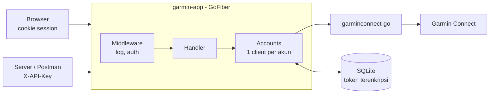

# Garmin Hub

REST API dan dashboard web untuk data Garmin Connect: Body Battery, tidur, HRV, aktivitas, berat badan, tekanan darah, dan workout. Backend Go (GoFiber) membungkus library [garminconnect-go](https://github.com/katarsisxyz/garminconnect-go); frontend React disajikan dari server yang sama.

> Proyek ini tidak resmi dan tidak berafiliasi dengan Garmin Ltd. Garmin Connect API yang dipakai bersifat privat dan bisa berubah sewaktu-waktu.

## Fitur

- **Dashboard web** (desktop dan mobile): Hari ini, Aktivitas, Tidur & recovery, Body, Workout.
- **Login akun Garmin** dengan email dan password, termasuk verifikasi 2 langkah (MFA). Password tidak pernah disimpan.
- **Token Garmin terenkripsi** (AES-GCM) di SQLite dan diperbarui otomatis saat di-refresh.
- **REST API** untuk ~60 endpoint: data harian, body, performa, aktivitas (termasuk unggah dan unduh file), workout, plus proxy untuk endpoint Garmin yang belum dibungkus.
- **Dua cara autentikasi**: cookie session (JWT) untuk browser, header `X-API-Key` untuk server dan Postman.
- **Log JSON** (logrus) satu baris per request, tanpa password atau token.

## Mulai cepat

Kebutuhan: Go 1.24+, Node.js 20+, `make`, dan `openssl`.

```sh
make setup   # install dependency, buat .env, generate secret
make dev     # backend :8080 + frontend dev server :5173
```

Buka http://localhost:5173, lalu login dengan akun Garmin Connect.

Untuk mode produksi (frontend di-build dan disajikan oleh backend di satu port):

```sh
make run     # build lalu jalankan di http://localhost:8080
```

## Perintah make

| Perintah | Fungsi |
| --- | --- |
| `make setup` | Install dependency Go dan npm, buat `.env` dari `.env.example`, isi secret yang masih kosong |
| `make dev` | Build backend, lalu jalankan backend (:8080) dan Vite (:5173) bersamaan |
| `make api` | Jalankan backend saja |
| `make web` | Jalankan Vite saja; `/api` dan `/auth` di-proxy ke :8080 |
| `make build` | Build frontend ke `web/dist` dan binary ke `bin/garmin-app` |
| `make run` | Build lalu jalankan versi produksi |
| `make test` | `go vet`, `go test`, dan type-check frontend |
| `make clean` | Hapus `bin/` dan `web/dist` |

## Konfigurasi

Semua konfigurasi lewat environment variable atau file `.env`. Variabel yang sudah ada di environment menang atas `.env`.

| Variabel | Wajib | Default | Keterangan |
| --- | --- | --- | --- |
| `API_KEY` | Ya | | Kunci untuk header `X-API-Key` (akses server-to-server ke semua akun) |
| `TOKEN_ENC_KEY` | Ya | | 64 karakter hex untuk mengenkripsi token Garmin. **Jangan diganti** setelah dipakai: token lama tidak bisa dibuka lagi |
| `JWT_SECRET` | Ya | | Minimal 32 karakter untuk menandatangani cookie session. Mengganti nilainya membuat semua browser logout |
| `DB_PATH` | | `data/garmin.db` | Lokasi file SQLite |
| `WEB_DIR` | | `web/dist` | Folder build frontend yang disajikan di `/` |
| `PORT` | | `8080` | Port HTTP |
| `LOG_LEVEL` | | `info` | `debug`, `info`, `warn`, atau `error`. `debug` juga menampilkan banner Fiber, tabel route, dan query SQL |

`make setup` membuat secret acak untuk variabel yang masih kosong dan tidak pernah menimpa nilai yang sudah ada.

## Cara kerja



1. Pengguna login lewat `/auth/login`. Backend login ke Garmin; jika akun memakai MFA, kode diminta lewat `/auth/mfa`.
2. Token Garmin disimpan terenkripsi di SQLite. ID akun web diambil dari Garmin profile ID.
3. Browser menerima cookie `session` (JWT, HttpOnly, berlaku 7 hari) dan memanggil `/api/v1/accounts/me/...`.
4. Setiap akun punya satu client Garmin di memori. Token di-refresh otomatis dan disimpan ulang.

Detail endpoint, format response, dan kode error ada di [docs/API.md](docs/API.md).

## Struktur proyek

```
.
├── main.go                 # konfigurasi, logger, database, routing, graceful shutdown
├── internal/
│   ├── accounts/           # client Garmin per akun, login + MFA, token store terenkripsi
│   ├── handler/            # route /api/v1 dan /auth
│   └── httpx/              # middleware auth (API key / JWT), logger, mapping error
├── web/                    # frontend React + Vite + Tailwind
├── docs/
│   ├── API.md              # referensi REST API
│   ├── PRD.md              # product requirements
│   └── design/             # desain FigCraft (dashboard, login, MFA)
├── postman/                # koleksi dan environment Postman
└── Makefile
```

## Dokumentasi

- [docs/API.md](docs/API.md): referensi endpoint, autentikasi, dan error
- [docs/PRD.md](docs/PRD.md): tujuan, keputusan desain, milestone, dan risiko
- [postman/](postman/): koleksi Postman siap import (61 request)
- `docs/design/garmin-app.figcraft`: file desain, dibuka dengan FigCraft

## Keamanan

- Password Garmin hanya dipakai untuk login dan tidak disimpan maupun di-log.
- Token Garmin dienkripsi AES-GCM dan tidak pernah dikirim ke client.
- Cookie session `HttpOnly` + `SameSite=Strict`; `Secure` otomatis saat diakses lewat HTTPS.
- Login dan MFA dibatasi 5 percobaan per menit per IP. Login password berulang dari satu IP bisa diblokir Cloudflare milik Garmin.
- Jangan set variabel `GARMINTOKENS`; library memakainya sebagai fallback dan bisa membuat token akun tertukar. Server menghapusnya saat start.
- Simpan `.env` di luar version control (sudah ada di `.gitignore`).

## Lisensi

[MIT](LICENSE) © 2026 Reza Afri Suhangga Hasibuan
