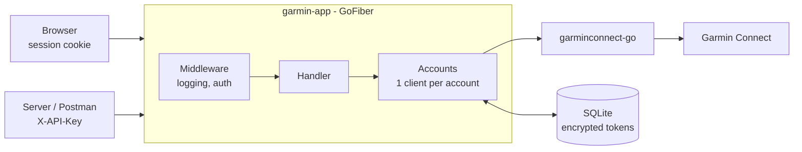

# Garmin Hub

**English** | [Bahasa Indonesia](README.id.md)

A REST API and web dashboard for Garmin Connect data: Body Battery, sleep, HRV, activities, weight, blood pressure, and workouts. The Go backend (GoFiber) wraps the [garminconnect-go](https://github.com/katarsisxyz/garminconnect-go) library, and the React frontend is served from the same server.

> This project is unofficial and not affiliated with Garmin Ltd. It relies on Garmin Connect's private API, which can change at any time.

## Features

- **Web dashboard** (desktop and mobile): Today, Activities, Sleep & recovery, Body, Workouts. The interface is in Indonesian.
- **Garmin account login** with email and password, including two-step verification (MFA). Passwords are never stored.
- **Encrypted Garmin tokens** (AES-GCM) in SQLite, saved again automatically whenever they refresh.
- **REST API** with about 60 endpoints: daily data, body, performance, activities (including file upload and download), workouts, and a proxy for Garmin endpoints that aren't wrapped yet.
- **Two ways to authenticate**: a session cookie (JWT) for browsers, an `X-API-Key` header for servers and Postman.
- **JSON logs** (logrus), one line per request, never containing passwords or tokens.

## Quick start

Requirements: Go 1.24+, Node.js 20+, `make`, and `openssl`.

```sh
make setup   # install dependencies, create .env, generate secrets
make dev     # backend on :8080 + frontend dev server on :5173
```

Open http://localhost:5173 and sign in with your Garmin Connect account.

For production mode (frontend built and served by the backend on one port):

```sh
make run     # build, then run on http://localhost:8080
```

## Make commands

| Command | What it does |
| --- | --- |
| `make setup` | Install Go and npm dependencies, create `.env` from `.env.example`, fill in empty secrets |
| `make dev` | Build the backend, then run the backend (:8080) and Vite (:5173) together |
| `make api` | Run the backend only |
| `make web` | Run Vite only; `/api` and `/auth` are proxied to :8080 |
| `make build` | Build the frontend into `web/dist` and the binary into `bin/garmin-app` |
| `make run` | Build, then run the production version |
| `make test` | `go vet`, `go test`, and a frontend type check |
| `make clean` | Remove `bin/` and `web/dist` |

## Configuration

Everything is configured through environment variables or a `.env` file. Variables already set in the environment win over `.env`.

| Variable | Required | Default | Description |
| --- | --- | --- | --- |
| `API_KEY` | Yes | | Key for the `X-API-Key` header (server-to-server access to every account) |
| `TOKEN_ENC_KEY` | Yes | | 64 hex characters that encrypt Garmin tokens. **Don't change it** once in use: stored tokens can no longer be decrypted |
| `JWT_SECRET` | Yes | | At least 32 characters; signs session cookies. Changing it signs every browser out |
| `DB_PATH` | | `data/garmin.db` | SQLite file location |
| `WEB_DIR` | | `web/dist` | Frontend build folder served at `/` |
| `PORT` | | `8080` | HTTP port |
| `LOG_LEVEL` | | `info` | `debug`, `info`, `warn`, or `error`. `debug` also prints Fiber's banner, the route table, and SQL queries |

`make setup` generates random secrets for empty variables and never overwrites existing values.

## How it works



1. The user signs in through `/auth/login`. The backend logs in to Garmin; if the account uses MFA, the code is requested through `/auth/mfa`.
2. Garmin tokens are stored encrypted in SQLite. A web account's ID is its Garmin profile ID.
3. The browser receives a `session` cookie (JWT, HttpOnly, valid for 7 days) and calls `/api/v1/accounts/me/...`.
4. Each account has one Garmin client in memory. Tokens refresh automatically and are saved again.

Endpoints, response format, and error codes are documented in [docs/API.md](docs/API.md) (in Indonesian).

## Project structure

```
.
├── main.go                 # configuration, logger, database, routing, graceful shutdown
├── internal/
│   ├── accounts/           # Garmin client per account, login + MFA, encrypted token store
│   ├── handler/            # /api/v1 and /auth routes
│   └── httpx/              # auth middleware (API key / JWT), logger, error mapping
├── web/                    # React + Vite + Tailwind frontend
├── docs/
│   ├── API.md              # REST API reference
│   ├── PRD.md              # product requirements
│   └── design/             # FigCraft designs (dashboard, login, MFA)
├── postman/                # Postman collection and environment
└── Makefile
```

## Documentation

- [docs/API.md](docs/API.md): endpoints, authentication, and errors
- [docs/PRD.md](docs/PRD.md): goals, design decisions, milestones, and risks
- [postman/](postman/): ready-to-import Postman collection (61 requests)
- `docs/design/garmin-app.figcraft`: design file, opens in FigCraft
- [CONTRIBUTING.md](CONTRIBUTING.md): how to set up, make a change, and send a pull request

The API reference and PRD are written in Indonesian.

## Security

- Garmin passwords are used only to sign in; they are never stored or logged.
- Garmin tokens are encrypted with AES-GCM and never sent to clients.
- Session cookies are `HttpOnly` + `SameSite=Strict`, and `Secure` automatically over HTTPS.
- Login and MFA are limited to 5 attempts per minute per IP. Repeated password logins from one IP can get blocked by Garmin's Cloudflare.
- Don't set the `GARMINTOKENS` variable: the library uses it as a fallback, which can mix up accounts' tokens. The server unsets it on start.
- Keep `.env` out of version control (it's already in `.gitignore`).

## License

[MIT](LICENSE) © 2026 Reza Afri Suhangga Hasibuan
