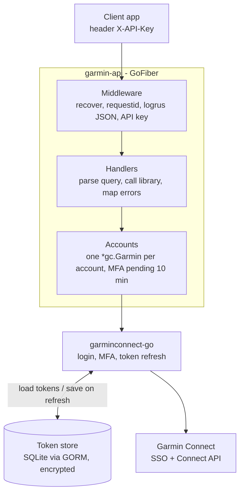

# PRD — Garmin Connect REST API

Tanggal: 2026-10-15

## Ringkasan

Kita membangun REST API (Go, GoFiber, logrus JSON) yang membungkus library [garminconnect-go](https://github.com/katarsisxyz/garminconnect-go) agar data Garmin Connect bisa diakses lewat HTTP oleh aplikasi lain.

Library sudah menangani login SSO, MFA, refresh token otomatis, dan sekitar 150 method (health, aktivitas, device, gear, workout, training plan, women's health, golf, nutrisi). Semua method mengembalikan JSON mentah Garmin (`json.RawMessage`), jadi API cukup meneruskannya tanpa memetakan ulang field.

Pekerjaan utama API ada di tiga hal: mengelola sesi/token per akun Garmin, memetakan query/path HTTP ke argumen method, dan memetakan error library ke status HTTP.

## Tujuan & non-tujuan

Tujuan v1:

- Satu API yang bisa menghubungkan banyak akun Garmin (connect dengan email + password, dukung MFA), lalu membaca datanya hanya dengan token.
- Endpoint read untuk data harian (summary, sleep, HR, HRV, stress, body battery), aktivitas, device, dan performa.
- Endpoint write yang paling sering dipakai: weigh-in, hydration, blood pressure, rename/delete aktivitas, upload file aktivitas, workout (upload/schedule).
- Token tersimpan terenkripsi dan otomatis tersimpan ulang saat di-refresh.
- Log terstruktur JSON (logrus) untuk setiap request, tanpa membocorkan password atau token.

Non-tujuan v1:

- Tidak membuat UI atau dashboard.
- Tidak mengubah bentuk JSON Garmin (tidak ada model domain sendiri); response diteruskan apa adanya.
- Tidak ada sinkronisasi/cron ke database sendiri; data selalu diambil live dari Garmin.
- Tidak membungkus semua ~150 method di v1; sisanya lewat endpoint proxy generik (`ConnectAPI`) atau ditambah bertahap.

## Pengguna & use case

Pengguna API adalah aplikasi client (mobile, web, bot) milik kita sendiri, bukan end-user langsung.

| Use case | Alur |
| --- | --- |
| Hubungkan akun Garmin | Client kirim email + password → API login ke Garmin → jika perlu MFA, client kirim kode → token disimpan |
| Tampilkan ringkasan harian | `GET /accounts/{id}/daily/summary?date=2026-10-15` |
| Riwayat tidur & recovery | Sleep, HRV, body battery, training readiness per tanggal atau rentang |
| Daftar & detail aktivitas | List aktivitas, detail, splits, HR zones, download GPX/FIT |
| Catat data manual | Tambah weigh-in, hydration, blood pressure |
| Kirim workout ke jam | Upload workout JSON, schedule ke tanggal, push ke device |
| Putuskan akun | Hapus token dan cache client |

## Kebutuhan fungsional: endpoint v1

Semua endpoint data berada di bawah `/api/v1/accounts/:accountId`. Tanggal pakai format `YYYY-MM-DD`; jika `date` kosong, library memakai hari ini. Rentang pakai `start` dan `end`.

### Koneksi akun

| Method | Path | Method library |
| --- | --- | --- |
| POST | `/api/v1/accounts/:accountId/connect` body `{email, password}` | `New(..., WithReturnOnMFA, WithTokenSaver)` + `Login` → `{mfa_required}` |
| POST | `/api/v1/accounts/:accountId/connect/mfa` body `{code}` | `ResumeLogin` |
| GET | `/api/v1/accounts/:accountId/status` | cek token tersimpan + `GetUserProfile` |
| DELETE | `/api/v1/accounts/:accountId` | hapus token + cache client |

### Profil & device

| Method | Path | Method library |
| --- | --- | --- |
| GET | `/profile` | `GetUserProfile` |
| GET | `/profile/settings` | `GetUserprofileSettings` |
| GET | `/devices` | `GetDevices` |
| GET | `/devices/:deviceId/settings` | `GetDeviceSettings` |
| GET | `/devices/last-used` | `GetDeviceLastUsed` |
| GET | `/gear` | `GetGear` |
| GET | `/gear/:uuid/stats` | `GetGearStats` |

### Health harian

| Method | Path | Method library |
| --- | --- | --- |
| GET | `/daily/summary?date=` | `GetUserSummary` |
| GET | `/daily/steps?date=` | `GetStepsData` |
| GET | `/daily/steps/range?start=&end=` | `GetDailySteps` |
| GET | `/daily/heart-rate?date=` | `GetHeartRates` |
| GET | `/daily/hrv?date=` | `GetHRVData` |
| GET | `/daily/stress?date=` | `GetStressData` |
| GET | `/daily/sleep?date=` | `GetSleepData` |
| GET | `/daily/body-battery?start=&end=` | `GetBodyBattery` |
| GET | `/daily/spo2?date=` | `GetSpo2Data` |
| GET | `/daily/respiration?date=` | `GetRespirationData` |
| GET | `/daily/hydration?date=` | `GetHydrationData` |
| POST | `/daily/hydration` body `{value_ml, date}` | `AddHydrationData` |
| GET | `/daily/intensity-minutes?date=` | `GetIntensityMinutesData` |

### Body

| Method | Path | Method library |
| --- | --- | --- |
| GET | `/body/composition?start=&end=` | `GetBodyComposition` |
| GET | `/body/weigh-ins?start=&end=` | `GetWeighIns` |
| POST | `/body/weigh-ins` body `{weight, unit, timestamp}` | `AddWeighIn` |
| DELETE | `/body/weigh-ins/:pk?date=` | `DeleteWeighIn` |
| GET | `/body/blood-pressure?start=&end=` | `GetBloodPressure` |
| POST | `/body/blood-pressure` body `{systolic, diastolic, pulse, timestamp, notes}` | `SetBloodPressure` |

### Performa & training

| Method | Path | Method library |
| --- | --- | --- |
| GET | `/performance/training-readiness?date=` | `GetTrainingReadiness` |
| GET | `/performance/training-status?date=` | `GetTrainingStatus` |
| GET | `/performance/max-metrics?date=` | `GetMaxMetrics` (VO2 max) |
| GET | `/performance/endurance-score?start=&end=` | `GetEnduranceScore` |
| GET | `/performance/race-predictions?start=&end=` | `GetRacePredictions` |
| GET | `/performance/hr-zones` | `GetHeartRateZones` |
| GET | `/performance/personal-records` | `GetPersonalRecord` |
| GET | `/training-plans` | `GetTrainingPlans` |

### Aktivitas

| Method | Path | Method library |
| --- | --- | --- |
| GET | `/activities?start=0&limit=20&type=` | `GetActivities` |
| GET | `/activities/by-date?start=&end=&type=` | `GetActivitiesByDate` |
| GET | `/activities/:id` | `GetActivity` |
| GET | `/activities/:id/details` | `GetActivityDetails` |
| GET | `/activities/:id/splits` | `GetActivitySplits` |
| GET | `/activities/:id/hr-zones` | `GetActivityHRInTimezones` |
| GET | `/activities/:id/weather` | `GetActivityWeather` |
| GET | `/activities/:id/download?format=gpx` | `DownloadActivity` (binary) |
| PATCH | `/activities/:id` body `{name, description}` | `SetActivityName`, `SetActivityDescription` |
| DELETE | `/activities/:id` | `DeleteActivity` |
| POST | `/activities/upload` multipart file (FIT/GPX/TCX) | `UploadActivity` (simpan ke temp file dulu) |

### Workout

| Method | Path | Method library |
| --- | --- | --- |
| GET | `/workouts?start=&limit=` | `GetWorkouts` |
| GET | `/workouts/:id` | `GetWorkoutByID` |
| POST | `/workouts` body JSON workout | `UploadWorkout` |
| DELETE | `/workouts/:id` | `DeleteWorkout` |
| POST | `/workouts/:id/schedule` body `{date}` | `ScheduleWorkout` |
| POST | `/workouts/:id/push` body `{device_id}` | `PushWorkoutToDevice` |

### Proxy generik

| Method | Path | Method library |
| --- | --- | --- |
| GET | `/raw?path=/wellness-service/...` | `ConnectAPI` — untuk endpoint yang belum dibungkus |

## Autentikasi & manajemen sesi

Ada dua lapis auth: client ke API kita memakai API key, dan API kita ke Garmin memakai token per akun.

**Client → API.** Header `X-API-Key` dicek middleware Fiber terhadap env `API_KEY`. Tanpa key yang benar → 401. `accountId` adalah ID bebas dari sistem client (misal user ID).

**API → Garmin.**

1. `POST /connect` membuat `gc.New(email, password, WithReturnOnMFA(), WithTokenSaver(save))` lalu `Login(ctx, "")`.
2. Jika `needsMFA=true`, client disimpan di map pending selama 10 menit dan API menjawab `{"mfa_required": true}`.
3. `POST /connect/mfa` memanggil `ResumeLogin(code)`; kode salah boleh diulang.
4. Token dari `WithTokenSaver` disimpan terenkripsi (AES-GCM, key dari env `TOKEN_ENC_KEY`) di tabel SQLite `garmin_accounts` lewat GORM.
5. Request berikutnya: ambil `*gc.Garmin` dari cache in-memory per `accountId`; jika belum ada, buat dari token tersimpan dengan `Login(ctx, tokenJSON)`.
6. Jika Garmin mengembalikan `ErrAuthentication`, client dihapus dari cache dan API menjawab 401 `garmin_reauth_required`.

Aturan keamanan:

- Password Garmin tidak pernah disimpan dan tidak pernah di-log.
- Token tidak pernah keluar di response atau log.
- Env `GARMINTOKENS` tidak boleh di-set (library memakainya sebagai fallback dan bisa membuat akun tertukar).
- Connect dilakukan satu per satu; login password berulang dari IP yang sama bisa diblok Cloudflare (429).

## Kebutuhan non-fungsional

| Area | Keputusan |
| --- | --- |
| Bahasa & runtime | Go 1.24+ (mengikuti `go.mod` library) |
| HTTP framework | GoFiber v2 (`github.com/gofiber/fiber/v2`), middleware bawaan `recover` dan `requestid` |
| Logging | logrus dengan `logrus.JSONFormatter`, satu log per request: `request_id`, `method`, `path`, `status`, `latency_ms`, `account_id`, `error` |
| Level log | Dari env `LOG_LEVEL` (default `info`); error Garmin 5xx/jaringan = `error`, 4xx = `warn` |
| Data sensitif | Field `password`, `code`, token, dan header `X-API-Key` tidak pernah di-log |
| Konfigurasi | Env saja: `PORT`, `API_KEY`, `TOKEN_ENC_KEY`, `DB_PATH`, `LOG_LEVEL` |
| Timeout | Context request diteruskan ke library; timeout per request 30 detik |
| Concurrency | Satu `*gc.Garmin` per akun, dipakai bersama antar goroutine (library aman untuk concurrent use) |
| Rate limit Garmin | Tidak polling; 429 dari Garmin diteruskan sebagai 429 ke client |
| Retry | Default library: 3x untuk 5xx/network pada operasi read |
| Shutdown | Graceful shutdown saat SIGINT/SIGTERM (`app.ShutdownWithTimeout`) |
| Health check | `GET /healthz` → 200 `{"status":"ok"}` tanpa API key |

**Database.** SQLite dengan GORM, driver pure Go `github.com/glebarez/sqlite` (tanpa CGO, jadi build dan Docker image tetap sederhana). File database dari env `DB_PATH` (default `data/garmin.db`), dipakai hanya untuk token store. Skema dibuat dengan `AutoMigrate`:

```go
type GarminAccount struct {
    AccountID string `gorm:"primaryKey"`
    Tokens    []byte `gorm:"not null"` // token JSON terenkripsi AES-GCM
    UpdatedAt time.Time
}
```

Token disimpan dengan upsert (`clause.OnConflict`) setiap `WithTokenSaver` terpanggil, dan dihapus saat disconnect. State MFA pending tetap in-memory. Log query GORM diarahkan ke logrus pada level `debug`.

Library memakai `*slog.Logger` untuk debug log internalnya; v1 tidak menghubungkannya ke logrus (default library: discard).

## Arsitektur & struktur project



Request lewat middleware, handler mengambil client akun dari cache Accounts, lalu library yang bicara ke Garmin; token dimuat dari dan disimpan kembali ke token store.

Struktur dibuat datar, cukup satu package `main` plus satu package internal per tanggung jawab:

```
garmin-app/
├── main.go              # config env, logrus, Fiber app, routes, graceful shutdown
├── internal/
│   ├── accounts/        # cache *gc.Garmin, connect/MFA, token store (GORM + SQLite)
│   ├── handler/         # handler per grup: daily, body, activity, workout, ...
│   └── httpx/           # middleware (API key, logger) + error mapper
├── go.mod
└── Dockerfile
```

## Format response & error

Response sukses meneruskan JSON Garmin apa adanya dengan `Content-Type: application/json`, tanpa envelope. Download aktivitas mengembalikan byte file dengan `Content-Type` sesuai format. Jika Garmin mengembalikan body kosong, API menjawab 204.

Response error selalu berbentuk:

```json
{"error": {"code": "garmin_rate_limited", "message": "too many requests", "request_id": "b1c2..."}}
```

| Error library / kondisi | HTTP | `code` |
| --- | --- | --- |
| API key salah/kosong | 401 | `unauthorized` |
| Validasi input di handler (tanggal, ID) | 400 | `invalid_argument` |
| `ErrInvalidArgument` | 400 | `invalid_argument` |
| `ErrInvalidFileFormat` | 400 | `invalid_file_format` |
| Akun belum di-connect | 409 | `account_not_connected` |
| Tidak ada login MFA pending / kedaluwarsa | 409 | `mfa_not_pending` |
| `ErrAuthentication` | 401 | `garmin_reauth_required` |
| `ErrNotFound` | 404 | `not_found` |
| `ErrTooManyRequests` | 429 | `garmin_rate_limited` |
| `ErrConnection` / lainnya | 502 | `garmin_unavailable` |
| Panic / bug internal | 500 | `internal_error` |

Pengecekan memakai `errors.Is`, dengan urutan `ErrNotFound` sebelum `ErrConnection` (karena not-found juga match `ErrConnection`). Pesan error dari library bisa berisi detail Garmin, jadi `message` ke client memakai teks generik dan detail lengkap hanya di log.

## Milestone

1. **M1 — Fondasi:** setup Fiber, logrus JSON, config env, middleware API key, `/healthz`, error mapper.
2. **M2 — Koneksi akun:** database SQLite via GORM + token store terenkripsi, cache client, connect + MFA, status, disconnect.
3. **M3 — Read endpoint:** profil, device, health harian, body, performa, aktivitas, proxy `raw`.
4. **M4 — Write endpoint:** weigh-in, hydration, blood pressure, patch/delete/upload aktivitas, workout.
5. **M5 — Hardening:** test handler dengan server Garmin palsu (`httptest`), Dockerfile dengan volume untuk file SQLite, dokumentasi OpenAPI.

## Risiko

| Risiko | Dampak | Mitigasi |
| --- | --- | --- |
| Garmin mengubah API privatnya | Endpoint tertentu error 4xx/5xx | Update library; jalankan `cmd/smoke` library saat ada error |
| Login password diblok Cloudflare (429) | Akun baru gagal connect | Connect satu per satu; pesan jelas ke client untuk coba lagi nanti |
| Refresh token kedaluwarsa | Akun perlu connect ulang | Kembalikan 401 `garmin_reauth_required` agar client meminta login ulang |
| Kebocoran token | Akses penuh ke akun Garmin user | Enkripsi at rest, tidak pernah di-log atau dikembalikan |
| State MFA pending hilang saat restart | User harus mulai connect ulang | Diterima untuk v1 (TTL 10 menit, in-memory) |
| SQLite hanya cocok untuk satu instance | Tidak bisa scale horizontal | Pindah ke PostgreSQL bila perlu replica; cukup ganti driver GORM |

## Open questions

- [ ] Perlu migration tool terpisah (misal golang-migrate), atau `AutoMigrate` GORM cukup untuk v1?
- [ ] Perlu caching response (misal summary 5 menit) untuk mengurangi rate limit Garmin?
- [ ] Endpoint women's health, golf, nutrisi, badges, jet lag perlu masuk v1 atau cukup lewat proxy `raw`?
- [ ] Akun garmin.cn perlu didukung (`WithCN`)?
- [ ] API ini multi-akun (tiap user connect akun Garmin sendiri) atau cukup satu akun pribadi?
